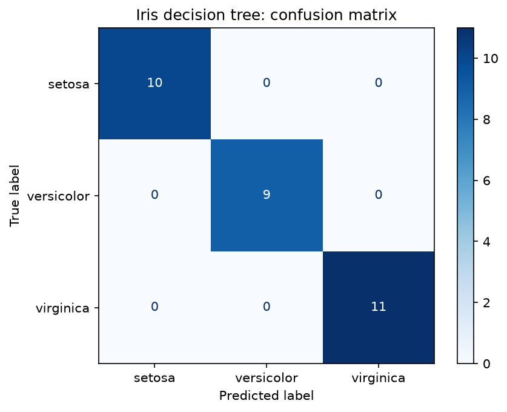

# Iris Classifier (Decision Tree)

## Overview

This project sorts iris flowers into one of 3 species (setosa, versicolor, virginica) using four measurements of each flower.

The dataset has 150 flowers, with 4 measurements each (sepal length, sepal width, petal length, petal width, in cm). It comes built into scikit-learn (a free Python library for machine learning), so no download is needed.

## Quick start

```bash
git clone https://github.com/bilalajadi/iris-classifier-bilal-ajadi.git
cd iris-classifier-bilal-ajadi
python -m venv venv
source venv/bin/activate        # macOS / Linux
# venv\Scripts\activate         # Windows Command Prompt
pip install -r requirements.txt
python src/train.py --test-size 0.2 --random-state 42
```

Open the walk-through notebook:

```bash
jupyter notebook notebooks/iris_model.ipynb
```

### Options

| Option | Default | Meaning |
| --- | --- | --- |
| `--test-size` | 0.2 | Share of the data kept aside for testing |
| `--random-state` | 42 | Fixes the random shuffle so results are the same every run |

## Results

With `--test-size 0.2 --random-state 42` (120 flowers for training, 30 for testing):

| Metric | Value |
| --- | --- |
| Test accuracy | 1.000 (all 30 correct) |
| Confusion matrix | Every prediction on the diagonal, so no mistakes (see `outputs/confusion_matrix.png`) |



The tree's first question is "is the petal shorter than 2.45 cm?". That alone picks out every setosa. The rest of the questions use petal length and width to tell versicolor from virginica, the two species that look most alike.

### Limitations

- 30 test flowers is a small test. One mistake would drop accuracy by about 3%, and a different random split could score lower. Testing on several different splits (cross-validation) would give a fairer score.
- The tree keeps asking questions until it gets every training flower right. On messier real-world data, this could make it memorise noise instead of learning the real pattern.

## Project structure

```
iris-classifier/
├── data/                   # empty: Iris is loaded from scikit-learn
├── notebooks/
│   └── iris_model.ipynb    # walk-through notebook
├── src/
│   └── train.py            # command-line script that runs the whole workflow
├── outputs/                # created by train.py (confusion matrix picture)
├── .gitignore
├── LICENSE
├── README.md
└── requirements.txt